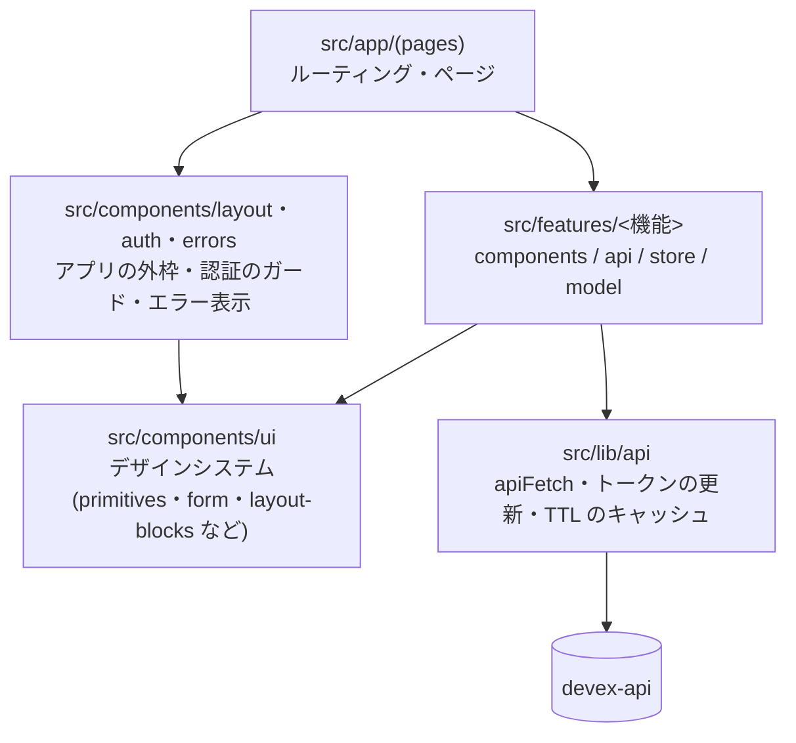

# devex-ui

[Devex](https://github.com/yd-uai-coder/devex-project#readme)(AIとの対話で要件を引き出し、要件定義から設計・実装手順・テストまでを、IDでつながった設計情報として組み立てるシステム)のフロントエンドです。Next.js(App Router)+ Tamagui で構築しています。バックエンドは [devex-api](https://github.com/yd-uai-coder/devex-api#readme) です。

本番: <https://devex.uandi-tech.com/>(Vercel)

## 主な機能

ログインが必要な画面は `src/app/(pages)/(protected)/` の下にあります。

| 機能 | 画面 | 実装 |
|---|---|---|
| 認証 | `/login`・`/register` | `src/features/auth/` ── メールとパスワード、または Google アカウントでのログインと登録 |
| ダッシュボード | `/dashboard`・`/projects/new` | `src/features/dashboard/` ── プロジェクトの一覧(検索・絞り込み・ページ送り)・作成(参考資料の添付)・削除 |
| ヒアリング | `/projects/[id]/chat` | `src/features/hearing/` ── AI とのチャット(SSE)、選択肢カードでの回答、観点ごとの状態の表、完了の判定 |
| 文書 | `/projects/[id]/documents` | `src/features/documents/` ── 4文書の生成と進み具合、タブでの表示・版の履歴と復元・ダウンロード、テスト仕様書 |
| 詳細設計モード | `/projects/[id]/detailed-design` | `src/features/detailed-design/`・`src/features/uml/` ── 段階ごとの生成・編集・承認、UML 設計図の編集(React Flow)と draw.io / SVG の出力、実装手順書、陳腐化の印と変更の影響 |
| AI 設計レビュー | (文書・詳細設計の画面の中) | `src/features/design-review/` ── 指摘の一覧と採否、レビュー結果からの再ヒアリング |
| マイページ | `/mypage` | `src/features/mypage/` ── アカウントの変更、Google の連携と解除、用途ごとのモデルと API キーの登録 |

`src/features/*/demo/` と `/design-review-demo` は、画面を作る前に仮データで見せ方を確かめた試作です。

## アーキテクチャ



- **機能ごとに閉じる** ── 画面の部品・API の呼び出し・Zustand のストア・純粋な変換のロジック(`*Ops.ts`・`model.ts`)を `src/features/<機能>/` にまとめます。ロジックは純粋な関数に分け、部品から切り離してテストします。
- **デザインシステムは機能に依存しない** ── `src/components/ui/` は、ボタン・入力・ダイアログ・グリッドなどの共通の部品です。`features` から使われる側で、`features` を import しません。
- **ページは薄く** ── `src/app/` のページは、Tamagui を使う本体(Client Component)へ描画を任せるだけにします(Server Component から Tamagui を直接 import すると落ちるため。`CLAUDE.md` 参照)。

## 設計の要点

- **HTTP クライアントは1つ** ── `src/lib/api/client.ts` の `apiFetch<T>()` が、ベース URL・`Authorization` の付与・FastAPI のエラー形式(`{detail, code}`)の解釈・`204` を受け持ちます。401 のときは1回だけ透過的にトークンを更新して再試行し、失敗したらログアウトします。
- **トークンの置き場所** ── アクセストークンはメモリ(Zustand のストア)だけに持ち、永続化しません。リフレッシュトークンは devex-api が httpOnly Cookie で発行し、画面からは読めません。ページを開いたときに Cookie から復元し(`AuthBootstrap`)、有効期限の60秒前に自動で更新します。同時の更新は1回にまとめます。
- **ログイン済みの判定を2段にする** ── `src/proxy.ts` が「ログインの印」の Cookie を見て、ログイン済みなら `/login`・`/register` を飛ばします。本当の確認は各ページの `RequireAuth` が行います。
- **データの鮮度は自前の TTL で管理する** ── React Query・SWR は使わず、機能ごとのストアに `data`・`status`・`error`・`fetchedAt` を持たせ、`isCacheFresh(fetchedAt)`(既定20秒)で取り直すかを決めます。更新が成功したら、関係するストアの `fetchedAt` を `null` に戻します。依存を増やさず、画面の状態とサーバーの状態を同じストアで扱うための選択です。
- **生成の進み具合はポーリング** ── 文書の生成はバックグラウンドで走るので、`useGenerationPolling` が進み具合を取りに行き、終わったら止めます。
- **フォームは React Hook Form + Zod** ── スキーマは各機能の `schemas.ts` か `src/lib/schemas/` に置きます。

Tamagui・Next.js 16 で実際に詰まった点(Server Component からの import、CSS Module が本番ビルドだけ負ける件など)は [`CLAUDE.md`](./CLAUDE.md) にまとめています。

## テスト

| 種類 | 道具 | 中身 |
|---|---|---|
| 単体・コンポーネント | Vitest + React Testing Library + user-event | 約160ファイル・約1,000ケース。テスト対象と同じディレクトリの `__tests__/` に置く。純粋なロジックは素で、API は `src/lib/api/test-utils/` のフェイクで差し替える |
| E2E | Playwright | 4ファイル・9テスト(`e2e/`)。devex-api を偽の LLM(`E2E_FAKE_LLM=true`)で、画面を偽の Google のボタン(`NEXT_PUBLIC_E2E_FAKE_GOOGLE=true`)で起動し、ログイン → ヒアリング → 生成・再生成、設計レビュー、詳細設計の段階1〜7、一覧の検索と削除、Google での登録・連携を通す |

```bash
npm run test                     # 単体・コンポーネント(手元で時間切れが出るときは npx vitest run --maxWorkers=4)
npx vitest run src/features/hearing   # ディレクトリを絞る
npm run test:e2e                 # E2E(devex-api を ../devex-api に置いておく。playwright.config.ts が両方を起動する)
```

## 技術スタック

| 分類 | 技術 |
|---|---|
| フレームワーク | Next.js 16(App Router、Turbopack)、React 19、TypeScript |
| UI | Tamagui(`@tamagui/config/v5`、CSS のアニメーション)、React Flow(`@xyflow/react`。UML の編集) |
| 状態 | Zustand(機能ごとに1つのストア) |
| フォーム | React Hook Form + Zod |
| 認証 | `@react-oauth/google`(Google でのログイン) |
| テスト | Vitest、React Testing Library、Playwright |
| Lint | ESLint(`eslint-config-next`) |

## ディレクトリ構成

```text
src/
├── app/
│   ├── (pages)/                  # ページ(TOP・ログイン・登録・試作のデモ)
│   │   └── (protected)/          # ログインが必要なページ(ダッシュボード・プロジェクト・マイページ)
│   ├── layout.tsx / providers.tsx
│   └── not-found.tsx
├── features/<機能>/              # 機能ごとの部品・API・ストア・ロジック(上の「主な機能」)
├── components/
│   ├── ui/                       # デザインシステム(primitives / form / data / layout-blocks / media)
│   ├── layout/                   # ヘッダー・メニュー・フッター・トースト
│   ├── auth/                     # 認証のストア・ガード・ログアウト
│   └── errors/                   # 404・生成の失敗の表示
├── hooks/                        # 機能をまたぐフック(生成のポーリングなど)
├── lib/
│   ├── api/                      # apiFetch・ベース URL・キャッシュ・ダウンロード・型
│   ├── schemas/                  # 共通の Zod のルール
│   └── menu-tree.ts              # メニュー・TOP・404 が共有するナビゲーションの定義
└── proxy.ts                      # ログイン済みのときに認証ページを飛ばす
e2e/                              # Playwright のシナリオ
tamagui.config.ts                 # テーマ(既定に足したキーは CLAUDE.md 参照)
```

## セットアップ

```bash
npm install
cp .env.example .env.local
npm run dev        # http://localhost:3000(devex-api は http://localhost:8000 で起動しておく)
```

| 変数 | 説明 |
|---|---|
| `NEXT_PUBLIC_API_URL` | devex-api のベース URL。未設定なら `http://localhost:8000` |
| `NEXT_PUBLIC_GOOGLE_CLIENT_ID` | Google でのログインの OAuth クライアント ID(devex-api の `GOOGLE_CLIENT_ID` と同じ値)。空なら Google のボタンを出さない |
| `NEXT_PUBLIC_E2E_FAKE_GOOGLE` | E2E 専用。`true` で偽の Google のボタンにする。本番・通常の開発では設定しない |

`NEXT_PUBLIC_` の値はビルドのときに埋め込まれます。

## コマンド

```bash
npm run dev         # 開発サーバー
npm run build       # 本番ビルド
npm run start       # 本番ビルドの起動
npm run lint        # ESLint
npm run test        # Vitest を1回
npm run test:watch  # Vitest の watch
npm run test:e2e    # Playwright
```

## デプロイ・CI

- **デプロイ**: Vercel の GitHub 連携で、`main` への push を自動でデプロイします。Vercel の環境変数に `NEXT_PUBLIC_API_URL`(devex-api の公開 URL)と `NEXT_PUBLIC_GOOGLE_CLIENT_ID` を設定し、devex-api の `CORS_ORIGINS` に Vercel の URL を足します。手順は [devex-api の OPERATIONS.md](https://github.com/yd-uai-coder/devex-api/blob/main/OPERATIONS.md) にあります。
- **CI**: `.github/workflows/ci.yml` が、push と PR のたびに lint・単体テスト・ビルドを流します。

## 出自

自作の Next.js + Tamagui の UI テンプレートから作り始めました。`src/components/ui/` の部品と、`src/lib/api/` のクライアント・キャッシュの方針はテンプレートから引き継いだものです。Devex で使わないテンプレートのデモページ・部品・DB(SQLite/Drizzle)は削除しました。
